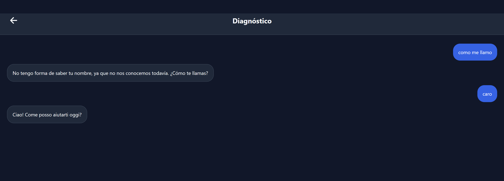

nuevas cosas a revisar:

en el dashboard tenemos un apartado de rachas, al hacer click muestra el modal de pregunta, al completarlo solo muestra "completado hoy" y el numero de racha, ahora me gustaria agregar esto: 
calendario interactivo para mostrar que dias de racha hemos tenido

el boton no guardar esta(rodada) no funciona, si cambiamos de apartado y regresamos la vuelve a mostrar
lo mismo pasa si pulsamos el boton de recordar mañana, salimos del modal, vamos a otro apartado, regresamos, vuelve a mostrarse aunque sea el mismo dia

en el apartado dashboard existe el Estado de tu Moto, aqui solo muestra una moto por defecto, mostrar cual querer mostrarse como top, opcion de mostrar todas en forma de lista, sea en apartado diferente(nueva pantalla/modal) o en el mismo bashboard

el apartado estado de tu moto muestra:
<View style={styles.metricsGrid}>
<View style={styles.metricItem}>
<Ionicons name="speedometer-outline" size={18} color={theme.textSecondary} />
<Text style={styles.metricValue}>{kilometrosTotales.toLocaleString('es-MX')} km</Text>
<Text style={styles.metricLabel}>Kilometraje registrado</Text>
</View>
<View style={styles.dividerVertical} />
<View style={styles.metricItem}>
<Ionicons name="build-outline" size={18} color={theme.textSecondary} />
<Text style={styles.metricValue}>{kilometrosTotales >= 1000 ? '¡Logro!' : `${Math.max(0, 1000 - kilometrosTotales)} km`}</Text>
<Text style={styles.metricLabel}>{kilometrosTotales >= 1000 ? 'Meta de 1,000 km' : 'Para los 1,000 km'}</Text>
</View>

es correcto que se traiga todo en motocicletas y eventos, el error ocurre que aunque en eventos marque una cantidad de kilometros, si abres el apartado de motocicletas esta misma moto marca 0 si tiene ese valor, es decir, se estan sumando ambos pero no se actualizan los valores, en lugar de recurrir a consultar ambos, se deberia actualizar lo que se tiene en motocicletas y usarse ese valor.

hay elementos visuales del apartado agenda que no tienen modo oscuro

en el modal denuevo evento(rodada) en el apartado moto asociada, debe mostrar las motos del usuario y un apartado especial que diga otro si solo fue con alguien mas(esta moto no debe repecutir en la bd(manejo de errores))

el chatbot esta muy desconfigurado

terminos de seguridad

politicas de privacidad

revisar el dashboard

revisar para que sirve tus logros en dashboard
